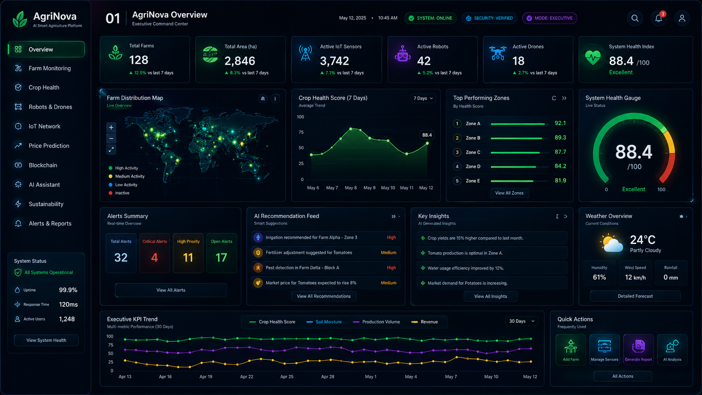

# AgriNova Power BI Enterprise Build Kit

## Overview

A Power BI reporting build kit for AgriNova's smart-agriculture demonstration. It supplies DAX measures, a report theme, visual guides, mockups, a semantic-model scaffold and PBIX/PBIP artifacts. The separate [web dashboard](web/README.md) is not required for Power BI.

## Technology and prerequisites

Power BI Desktop on Windows, Power Query/M, DAX, CSV and JSON/SVG assets. A specific Desktop version is not pinned. The PBIP descriptor declares format 1.0; this does not establish the required Desktop release. Python generator scripts exist under tools/, but the manual build requires no Python installation. No API keys, GPU or live sensor feed is required.

## Structure

- [../data/](../data/) — tracked demonstration CSVs; the previously documented Dashboard/data directory is not present in the current tree.
- [theme/agrinova_theme.json](theme/agrinova_theme.json) — report theme.
- [dax/agrinova_measures.dax](dax/agrinova_measures.dax) — measures.
- assets/ — SVG assets.
- [docs/build_steps.md](docs/build_steps.md), [docs/data_model.md](docs/data_model.md), [docs/report_layout.md](docs/report_layout.md) — assembly, relationships and visuals.
- [manual_build/](manual_build/README.md) — manual import and repair guidance.
- [powerbi/AgriNova/](powerbi/AgriNova/README.md) — report artifacts.

## Setup and usage

1. Clone the repository and open Power BI Desktop.
2. Follow [the manual import guide](manual_build/00_MASTER_POWER_BI_IMPORT_GUIDE.md). Import the CSVs from the repository root data/ directory.
3. Assign data types, mark the date table and create relationships according to the [build guide](docs/build_steps.md).
4. Import the theme and add DAX measures. Validate each measure against the CSV tables.
5. Build the pages, tooltips and drill-through navigation using the layout guides.
6. Alternatively inspect the existing PBIX/PBIP artifacts as explained in the artifact README. Repair absolute CSV paths in a local copy before refreshing.

## Configuration and data

No application environment variables are required. Power Query file paths must point to your local clone; do not reuse absolute paths from another computer. The demo uses farm, crop, sensor, date and operational fact tables. Calculated indicators are demonstrations, not measured ML performance.

## Visuals

See [mockup index](manual_build/05_MOCKUPS_INDEX.md). These PNGs are design references, not proof that every Power BI visual renders.

## Testing and limitations

See [validation report](docs/validation_report.md) for historical generated checks. Confirm imports, data types, relationships, DAX compilation, page navigation, tooltips, drill-through, refresh and PDF export in Power BI Desktop. Historical launch and repair reports are under manual_build/. No automated test suite or current successful Desktop execution was independently established. No live Power BI Service URL is verified. Dataset provenance and licensing must be confirmed for reuse.

See [repository license](../LICENSE).

## Author

Ramadan Mohamed Hassan — AI Engineer | AI Researcher | AI Automation | LLM & RAG Systems | Machine Learning

[Portfolio](https://ramadan-ai-portfolio.vercel.app/) · [LinkedIn](https://www.linkedin.com/in/ramadan-mohamed-89085a366/) · [GitHub](https://github.com/Rmadanmohamed) · [Email](mailto:ramadanmohameddd3@gmail.com)
