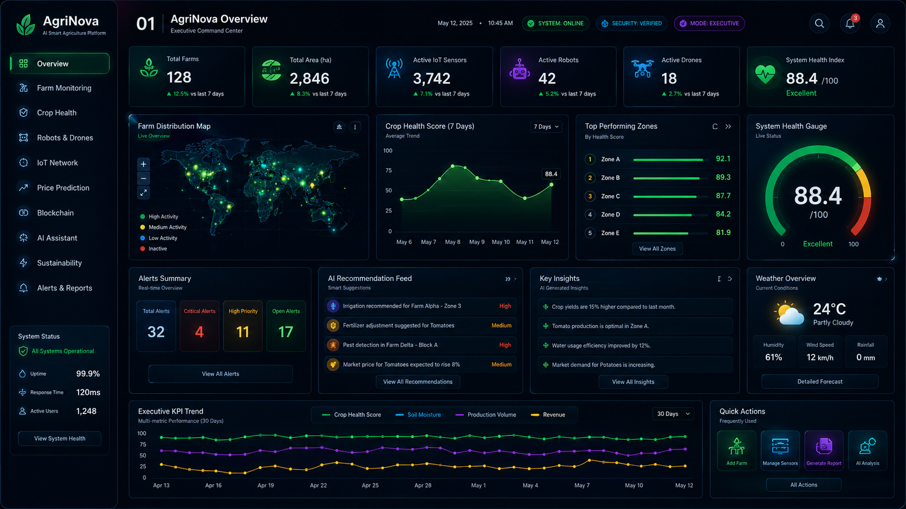

# AgriNova Power BI Report Artifacts

## Overview

Power BI report artifacts for the AgriNova demonstration reporting workspace. This directory is part of the [Power BI build kit](../../README.md), not a separate web application.

## Technology and prerequisites

Windows Power BI Desktop supporting PBIP and TMDL projects; no exact application version is pinned. AgriNova.pbip declares PBIP format 1.0. Power Query imports CSV data, while DAX implements report measures. No API credentials or environment variables are required for local CSV imports.

## Structure and opening instructions

- AgriNova.pbip — project descriptor.
- AgriNova_Final.pbix and AgriNova_Final_interactive_patch.pbix — report artifacts.
- AgriNova.SemanticModel/definition/ — tracked TMDL model definitions.

Open a copy of one of the PBIX files in Power BI Desktop. The PBIP references AgriNova.Report, but the current tracked tree does not establish a complete report definition; do not assume the PBIP opens successfully. Use the [manual build fallback](../../manual_build/README.md) if launch fails.

The inspected Farms.tmdl source uses a machine-specific absolute CSV path. Redirect data sources to the repository root [data directory](../../../data/) in a local copy before refreshing. Follow the [build steps](../../docs/build_steps.md) and [report layout](../../docs/report_layout.md).

## Usage and validation

Refresh CSV imports, confirm table relationships, validate DAX, and inspect each visual and navigation action. The repository contains historical validation and repair reports under [manual_build](../../manual_build/). The binary PBIX content was not executed or independently validated in this documentation audit. No automated test suite or verified public Power BI deployment was identified.

## Visual reference

The image is a design reference, not a verified screenshot of the PBIX. Data is demonstration material; no trained-model benchmark is asserted.

See [repository license](../../../LICENSE).

## Author

Ramadan Mohamed Hassan — AI Engineer | AI Researcher | AI Automation | LLM & RAG Systems | Machine Learning

[Portfolio](https://ramadan-ai-portfolio.vercel.app/) · [LinkedIn](https://www.linkedin.com/in/ramadan-mohamed-89085a366/) · [GitHub](https://github.com/Rmadanmohamed) · [Email](mailto:ramadanmohameddd3@gmail.com)
