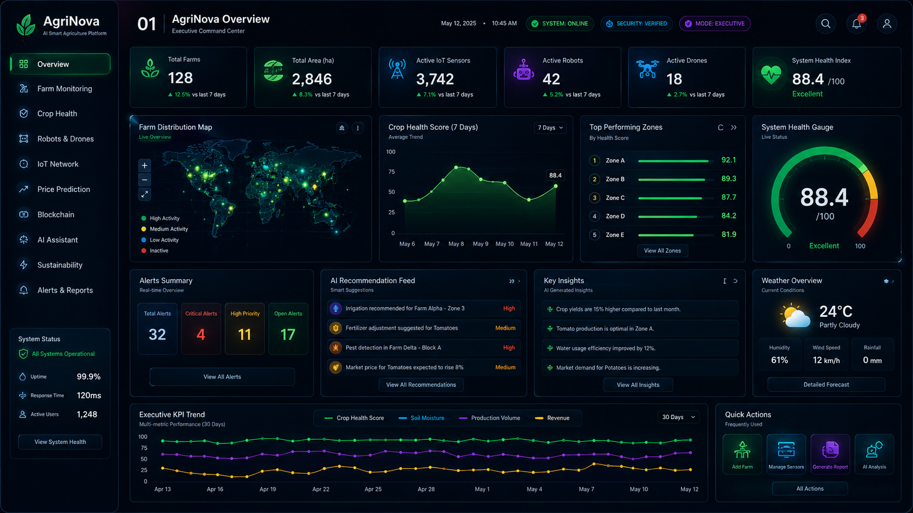

# AgriNova Web Dashboard

AgriNova is now a real component-based web dashboard with a Node/Express API and a React frontend. The prior image-overlay version has been replaced. The generated PNG mockups are not rendered in the app; they are only visual references for the dark futuristic style.

## Project Structure

```text
web/
├── frontend/
│   ├── package.json
│   ├── src/
│   └── ...
├── backend/
│   ├── package.json
│   ├── src/
│   └── ...
├── reference-images/
├── README.md
└── VALIDATION_REPORT.md
```

## Design References

The current tracked design references are under [../manual_build/mockups](../manual_build/mockups/). The previously documented web/reference-images directory is not present in the current tree. They are used as visual references only. The frontend does not render them as backgrounds or `` UI elements.

The page-to-reference mapping and design notes live in:

```text
web/frontend/src/design/referenceMap.ts
```

## Backend

The backend resolves its default CSV path to Dashboard/data, which is not tracked. Set AGRINOVA_DATA_DIR to the repository root data directory as shown below before starting. Run it with:

```bash
cd Dashboard/web/backend
npm ci
AGRINOVA_DATA_DIR="$(cd ../../../data && pwd)" npm run dev
```

Default API URL:

```text
http://127.0.0.1:4000
```

On Windows PowerShell, from Dashboard/web/backend:

```powershell
$env:AGRINOVA_DATA_DIR=(Resolve-Path ../../../data).Path
npm run dev
```

## Frontend

Run it with:

```bash
cd Dashboard/web/frontend
npm ci
npm run dev
```

Default frontend URL:

```text
http://127.0.0.1:5173
```

If the backend URL changes, set:

```bash
VITE_API_URL="http://127.0.0.1:4000/api" npm run dev
```

## Build

Backend:

```bash
cd Dashboard/web/backend
npm run build
```

Frontend:

```bash
cd Dashboard/web/frontend
npm run build
```

## API Documentation

All responses are JSON.

| Method | Endpoint | Description |
| --- | --- | --- |
| GET | `/api/farms` | Farm master data |
| GET | `/api/sensors` | Sensor inventory and communication status |
| GET | `/api/alerts` | Alert records and recommended actions |
| GET | `/api/soil-readings` | Soil moisture, pH, humidity, and irrigation readings |
| GET | `/api/weather-readings` | Farm weather readings |
| GET | `/api/crop-health` | Crop scan records and treatment recommendations |
| GET | `/api/price-predictions` | Approved fruit and vegetable price data only |
| GET | `/api/blockchain` | Traceability and ledger records |
| GET | `/api/ai-recommendations` | AgriNova AI Assistant recommendation records |
| GET | `/api/energy` | Sustainability and energy usage records |
| GET | `/api/robot-missions` | Robot mission records |
| GET | `/api/drone-missions` | Drone mission records |
| GET | `/api/summary` | Calculated dashboard KPIs |
| GET | `/api/health` | Backend health and CSV folder confirmation |

## Pages

The frontend includes 10 real React pages:

1. Overview
2. Smart Farm Monitoring
3. Crop Health & Vision Intelligence
4. Robotics & Drone Operations
5. IoT Sensor Network
6. Price Prediction
7. Blockchain Security
8. AI Assistant
9. Sustainability & Energy
10. Alerts & Reports

## Price Data Rule

The price endpoint and frontend use only:

Tomatoes, Bell Pepper, Onion, Cucumber, Potato, Orange, Mandarin, Apple, Banana, Mango, Grapes, Strawberry, Lemon, Pomegranate.

## Deployment

Deploy the backend as a Node service and the frontend as a static Vite app. For Netlify or Vercel frontend hosting, use:

```text
Root: Dashboard/web/frontend
Build command: npm run build
Output directory: dist
```

Set `VITE_API_URL` to the deployed backend API base URL ending in `/api`.

## Versions and prerequisites

Node.js 20+ (a supported LTS version recommended), npm, and the root CSV data. The backend lock resolves Express 4.22.2, cors 2.8.6, csv-parse 5.6.0, tsx 4.22.2 and TypeScript 5.9.3. The frontend lock resolves React 18.3.1, Vite 6.4.2, TypeScript 5.9.3, Tailwind CSS 3.4.19, Recharts 2.15.4, React Router 6.30.3 and Framer Motion 11.18.2. See the separate package manifests and lockfiles. Run the two services in separate terminals from the repository root; clone https://github.com/Rmadanmohamed/agrinova-smart-agriculture-dashboard.git if needed.

## Environment variables

| Variable | Required | Purpose |
|---|---|---|
| AGRINOVA_DATA_DIR | Yes for the current checkout | Absolute path to root data/; default Dashboard/data is absent |
| PORT | No | Backend HTTP port, default 4000 |
| VITE_API_URL | No | Frontend API base, default http://127.0.0.1:4000/api |

No API keys are needed for the CSV-backed demo.

## Architecture and evaluation

CSV fixtures → Express endpoints → frontend fetch service → React pages/charts. Backend calculations aggregate farm/sensor/alert status, average health and latest approved crop prices. These records are demonstration inputs, not live sensors, model inference or a real blockchain connection. The historical validation report [VALIDATION_REPORT.md](VALIDATION_REPORT.md) records earlier builds and manual API/browser checks; no builds or tests were executed in this documentation audit. No dedicated automated suite was found. After startup, request http://127.0.0.1:4000/api/health and /api/summary, then inspect all ten pages. Do not expose the permissive CORS configuration or diagnostic endpoint publicly without security review.

## Visuals and demo



This is a tracked design reference, not an independently captured application screenshot. No separate live deployment URL for this React/Express implementation is verified. See [repository license](../../LICENSE).

## Author

Ramadan Mohamed Hassan — AI Engineer | AI Researcher | AI Automation | LLM & RAG Systems | Machine Learning

[Portfolio](https://ramadan-ai-portfolio.vercel.app/) · [LinkedIn](https://www.linkedin.com/in/ramadan-mohamed-89085a366/) · [GitHub](https://github.com/Rmadanmohamed) · [Email](mailto:ramadanmohameddd3@gmail.com)
