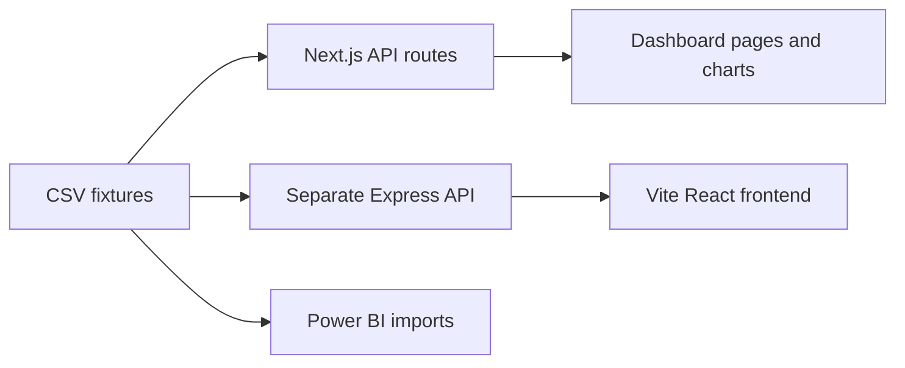
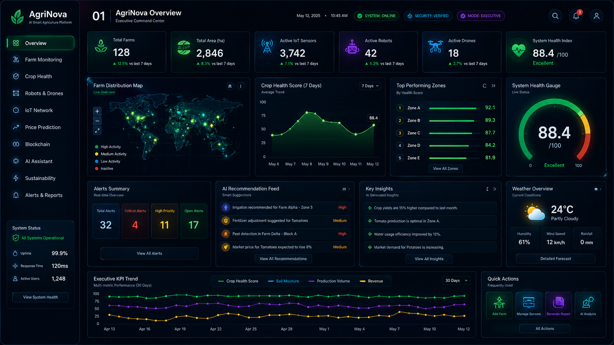

# AgriNova Smart Agriculture Dashboard

## Overview

A smart-agriculture demonstration workspace for monitoring farms, crop health, IoT sensors, drones and robotics, prices, traceability, recommendations, energy and alerts. It contains three distinct implementations: a Next.js dashboard at the root, a separate React/Express web dashboard, and a Power BI reporting kit. The tracked CSVs are demonstration data, not evidence of live hardware, operational blockchain, or trained-model inference.

## Projects

| Project | Location |
|---|---|
| Next.js dashboard and API | Repository root |
| React + Express dashboard | [Dashboard/web](Dashboard/web/README.md) |
| Power BI build kit | [Dashboard](Dashboard/README.md) |
| Power BI artifacts | [Dashboard/powerbi/AgriNova](Dashboard/powerbi/AgriNova/README.md) |

## Root application stack

| Dependency | Manifest | npm lock |
|---|---|---|
| Next.js | 16.2.6 | 16.2.6 |
| React / React DOM | ^19 | 19.2.6 |
| TypeScript | 5.7.3 | 5.7.3 |
| Tailwind CSS | ^4.2.0 | 4.3.0 |
| Recharts | 2.15.0 | 2.15.0 |
| csv-parse | ^6.2.1 | 6.2.1 |

See package.json and package-lock.json for other UI dependencies.

## Architecture



## Prerequisites and setup

Node.js 20.9+ (Next.js 16 minimum), npm, and the tracked CSV files. No database or GPU is needed.

```bash
git clone https://github.com/Rmadanmohamed/agrinova-smart-agriculture-dashboard.git
cd agrinova-smart-agriculture-dashboard
npm ci
npm run dev
```

Open http://localhost:3000. For a production build:

```bash
npm run build
npm start
```

## Configuration

The root API uses process.cwd()/data and does not require custom API keys or environment variables for the reviewed CSV routes. Run from the repository root. The nested web project has separate configuration documented in its README.

## Structure and usage

- app/ — Next.js pages and GET API handlers.
- components/dashboard/ and components/ui/ — shared layout and visual components.
- data/ — fifteen CSV fixtures, including farms, crops, dates, sensors, soil, weather, missions, scans, prices, recommendations, alerts, energy and reports.
- Dashboard/ — separate web and Power BI implementations.
- powerbi-semantic-model/ — additional model definitions.

Use the dashboard navigation to switch operational views. The API summary reads and aggregates CSV rows (counts, averages and status fields).

```bash
curl http://localhost:3000/api/summary
curl http://localhost:3000/api/farms
curl http://localhost:3000/api/crop-health
```

The summary handler returns fields including totalFarms, activeSensors, systemHealthIndex, alerts, avgTemperature and totalEnergy. These are calculations over fixtures rather than model evaluation metrics.

## Visuals and demo

Existing deployment link: [AgriNova dashboard](https://agri-nova-ai-dashboard.vercel.app). Live availability was not independently verified. The following tracked image is a design mockup, not a screenshot of the running root application.



## Testing and validation

Run npm run build, start the development server, request the endpoints above, and manually inspect each page. npm run lint is declared but its tooling configuration requires verification. No dedicated automated suite was identified for the root app. The nested web and Power BI historical validation records are linked from their own READMEs. Builds and tests were not executed during this documentation audit.

## Limitations

No live farm integrations, independent ML evaluation, authenticated blockchain network, or production authorization is established by this demonstration. Verify CSV provenance, schema and privacy before operational use. Configure and validate the deployment on Vercel separately.

## License

See [LICENSE](LICENSE).

## Author

Ramadan Mohamed Hassan — AI Engineer | AI Researcher | AI Automation | LLM & RAG Systems | Machine Learning

[Portfolio](https://ramadan-ai-portfolio.vercel.app/) · [LinkedIn](https://www.linkedin.com/in/ramadan-mohamed-89085a366/) · [GitHub](https://github.com/Rmadanmohamed) · [Email](mailto:ramadanmohameddd3@gmail.com)
